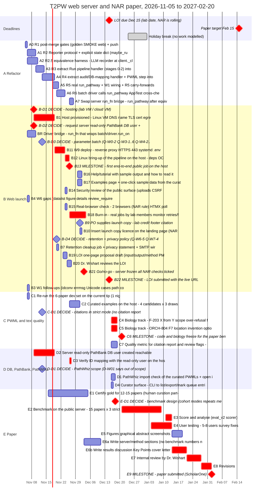

# T2PW web server: schedule assessment, 2026-11-05

- **Author:** independent planning assessor (general-purpose, opus/high). Read-only on the code. This is the only file written.
- **Tree:** `webserver/refactor` @ `cb5773d1` (the R1 merge).
- **Method:** I measured task durations from `git log` (merge-base to merge commit for every `ws/*` merge) and from LEDGER rows. I then ran a critical-path forward and backward pass over the task list in § 3 on a working-day calendar. The calculation is a scratch script and is not committed. The tables, Gantt chart and CSV below are its output.
- **Calendar:** weekdays only, with no work from 2026-12-24 to 2027-01-01. Local holidays are not modelled; if 11 November (Remembrance Day) is a holiday for the lab, it costs one day of slack. Weekend work is not counted, so any weekend work is extra buffer.
- **Unit:** "wd" means working day. The **slack** column counts working days to the deadline the task serves: the LOI for tasks marked LOI or both, the paper for tasks marked paper.

---

## 0. What NAR actually requires (checked 2026-11-05)

I fetched `https://academic.oup.com/nar/pages/submission_webserver` today. These are the page's own words where quoted.

| Item | What the page says | Effect on this plan |
|---|---|---|
| Proposal deadline | "Proposals can be submitted at any time (starting in November 2026)." It also says "There is no acceptance deadline." | **Dec 15 is the lab's own date, not a NAR deadline.** Missing it costs the lab's plan, not eligibility. |
| Manuscript deadline | "2 months after the date of the approval email". Proposal review "may take a few weeks". | A Dec 15 proposal gives a manuscript deadline of about **early to mid March 2027** (an estimate). The Feb 15 target therefore has about 3–4 weeks of official contingency. |
| Server state | It must work "on the date of the proposal submission". Reviewers test it, preferably on "at least two commonly used web browsers". | The server must be live, and running the real pipeline, **before** the LOI goes out. A stub does not qualify. |
| Proposal | One page or less, otherwise it is "not considered". It must give the input, output and method, PMIDs of earlier publications, 2–4 keywords, whether it is an update or resubmission, and the authors with affiliations. | Task B19. |
| Access | No login, no registration, and no mandatory email; a requested email must be stated as optional. "Websites that use a guest login will not be approved." | Already met: there is no login (`web/app.py:370`, "There is no cookie or login"), and email is optional (W8). |
| Licence | Free non-commercial access, with "a standard licence on the landing page". | Not met yet: `templates/about.html:10` is a placeholder, and the licence has to be on the **landing** page (B10). |
| Sample data, help | A simple way to run sample data, plus help and tutorial pages with sample output that explain how to read the results. A results link when output is not returned immediately. | B16 and B17. The results link already exists (W6 job page). |
| Privacy, cookies, HTTPS | Keep user data private. No third-party or tracking cookies. HTTPS on port 443. | W9 and B7 (retention and privacy text). |
| Maintenance | "maintained for at least five years". | Argues for a lab-owned host, not this development machine. |
| Manuscript | 4–5 printed pages, a graphical abstract, up to 3 Key Points, a cover letter listing similar servers with their URLs, and 6 suggested referees. The software must be "extensively tested at the time of submission". | Tasks E5–E8. |

**Not verified:**
- The proposal email address (the page hides it).
- Whether a manuscript submitted in March still makes the July 2027 issue. The page only says the issue appears in July.

---

## 1. Status summary

1. **Merged into `webserver/refactor`, each with a post-merge SMOKE of 511:** W0, W1, W2, W3, W4, W5, W6, W7, W7b and W8. That is the whole web layer except W9 (deploy). Web-layer baseline: 261 tests. R0 is done.
2. **R1 merged today** at `cb5773d1`. Its post-merge golden-seam, SMOKE and web runs are in flight (LEDGER current state).
3. **The public site runs only the W0 stub.** `run_pathway` returns "no pipeline ran" (`service/pathway.py:145-152`), so no public job has computed anything yet.
4. **Not started:** R2–R6, W9, the host, the server DB user, SMTP, launch copy and curated examples. About 35 PO questions are open (LEDGER "Open PO questions").
5. **Output quality today:**
   - Replay corpus: 79 of 91 strict legs write a PWML, and **1 of those 79 is `release_ready`** (`pwml_recovery_sprint/evidence/orch799/corpus_tip.txt:119-121, 30`).
   - Newest live run, on unseen papers (ORCH-801): 3 of 3 wrote a PWML, all `review_required`, and one needed 3 attempts (`ORCH-801-RESULT.md` § 2).
6. **Headline:** the code is not the bottleneck; external lead times and output quality are.

---

## 2. Time standards

### 2.1 What the history shows

Times are wall-clock times from `git log`: the merge-base commit to the merge commit (`<merge>^1..<merge>^2`). They are an upper bound on agent work, because the LEDGER dispatch rows are committed after the base commit.

| Task | Size | Review rounds | Base to merge | Note |
|---|---|---|---|---|
| W7b | S | 1 | 16 min (11-05 11:40 to 11:56) | |
| W7 | M | 2 | 16 min (11-04 21:28 to 21:44) | |
| W1 | M | 2 | 18 min (20:10 to 20:28) | |
| W4 | M | 2 | 21 min (21:00 to 21:21) | |
| W8 | M | 2 | 21 min (21:00 to 21:21) | |
| W2 | M | 2 | 25 min (20:12 to 20:37) | |
| W5 | L | 2 | 39 min (20:10 to 20:49) | |
| W3 | L | 3 | 47 min (20:10 to 20:57) | Process-lifecycle work |
| W6 | L | 2 | 14 h elapsed (11-04 21:28 to 11-05 11:37) | Machine restart overnight; about 1 h of active time |
| W0 | L | 3 | 1 h 40 min (18:27 to 20:07) | Escalated to opus/xhigh in round 2 |
| R1 | XL | 2 | 15 h elapsed (11-04 21:28 to 11-05 12:36) | Restart killed the session mid-task. Morning session 10:47 to 12:36, plus a full independent re-run (16 tip runs plus a base comparison) |
| ORCH-802 (sprint, biology) | M | 2 | 2 h 41 min | |
| ORCH-803 (sprint, biology) | M | 2 | 37 min | |
| ORCH-804 (sprint, biology) | — | — | — | REJECTED, **held** |

What this shows:

- **Agent coding time is small.** Eleven tasks merged in about 5.5 hours of orchestrated time across two sessions: Nov 4 18:27 to 21:49, and Nov 5 10:47 to 12:36.
- **Review rounds:** 23 rounds over 11 tasks, a mean of **2.1**. Ten of the 11 needed at least one fix round, two needed a third round, and none reached BLOCKED.
- **What actually spends calendar time:**
  1. Whether an orchestrated session is running. About one session a day was observed.
  2. **One heavy job at a time.** There have already been two overlap breaches, in W7 and W7b.
  3. Machine restarts: one in this track, and two forced shutdowns before it (memory).
  4. Live runs: 21–46 min per strict leg, worst case 102 min. ORCH-796 ran 6 papers in 3 h 28 min.
  5. People: PO rulings, which were fast when the PO was in session (Q-R0-1 took about 3 h on Nov 4), and **external parties, whose response time has never been measured**.
- **R3 and R4 have no precedent.** R1 moved code verbatim. R3 and R4 reshape inline handlers that hold 73+ `st.` references (PLAN § 1).

### 2.2 Standards

| Class | Definition | Measured basis | Timebox | Rule |
|---|---|---|---|---|
| S | One function or file, at most 1 review round | W7b, 16 min | 0.5 wd | Over 0.75 wd: the orchestrator re-scopes |
| M | One module plus tests, 2 rounds | W1, W2, W4, W7, W8 (16–25 min, median 21) | 1 wd | Over 1.5 wd (+50%): one model tier up |
| L | Interface, process lifecycle, site-wide UI, or deploy; 2–3 rounds | W5 39 min, W3 47 min, W6 about 1 h active, W0 1 h 40 min | 2 wd (3 for W9) | Over +50%: escalate to the PO with the § 7 cuts |
| XL | App refactor behind golden seams, with a chunked base-vs-tip comparison | R1: 15 h elapsed, one working session plus a restart | 3 wd | Over 4.5 wd: the PO picks a cut (defer R6 or keep the bridge) |
| Live run | Legs × 46 min × 1.5 for retries | ORCH-801 21–46 min/leg; ORCH-796 about 35 min/paper; ORCH-798 worst 102 min | About 10 legs per night | If a night completes under 70% of its legs: stop and triage the infrastructure, do not re-run blindly |
| External | Lab IT, DBA, Dr. Wishart | **Not measured** | 8 wd for IT/DBA, 2 wd LOI review, 5 wd paper review | No reply in 3 wd: the PO chases. No result at 8 wd: apply § 7 |
| PO decision | — | Q-R0-1 asked about 18:27 and ruled 21:28 on Nov 4; R1-F1/F6 ruled within about 1 h | The decide-by date in § 8 | Overdue by 2 wd: the orchestrator proceeds on the written default and records it in the LEDGER |

The timeboxes are about 20 times the measured agent time on purpose. They are calendar working days, and they absorb session availability, queuing behind one heavy job, restarts, and the 2 review rounds that are budgeted into every timebox. A third round goes one model tier up (ORCHESTRATOR § 3), and a third rejection means BLOCKED and a question to the PO.

**Buffer policy:**
- The LOI chain keeps **at least 5 wd of slack**. Below 5, apply the § 7 cuts in order. Below 2, the PO makes a go/no-go call on the fallback plan.
- The paper chain keeps at least 5 wd before Feb 15. The official two-month window is contingency, never planned work.
- Reserve 0.5 wd per week for development-machine incidents until the host exists.

---

## 3. Remaining work

`MS` marks a zero-length milestone or PO decision; its start date is its decide-by date. `EXT` means work done by someone outside the agent team. The "slack" column is an addition to the requested columns.

| id | track | task | depends on | size | estimate (wd) | earliest start | finish | slack (wd) | owner | needed for |
|---|---|---|---|---|---|---|---|---|---|---|
| A0 | A | R1 post-merge gates (golden, SMOKE, web) + push | - | S | 0.5 | 2026-11-05 | 2026-11-05 | +15.0 | ws-test-runner | both |
| A1 | A | R2 Reporter protocol + explicit state dict (maybe_run_rag, run_rag_rounds, run_quarantine_boundary) | A0 | M | 1.5 | 2026-11-06 | 2026-11-09 | +25.5 | ws-implementer opus/high; ws-reviewer opus | both |
| A2 | A | R2.5 equivalence harness: LLM recorder at client._client, isolated project roots, one live recording run | A0 | L | 2.5 | 2026-11-06 | 2026-11-10 | +24.5 | ws-implementer opus/high; ws-reviewer opus | both |
| A3 | A | R3 extract 'Run pipeline' handler (stages 0-2) into run_extraction | A1, A2 | XL | 3 | 2026-11-10 | 2026-11-13 | +26.5 | ws-implementer opus/high; ws-reviewer opus | paper |
| A4 | A | R4 extract audit/DB-mapping handler + PWML step into run_post_pipeline / run_export | A3 | XL | 3 | 2026-11-13 | 2026-11-18 | +26.5 | ws-implementer opus/high; ws-reviewer opus | paper |
| A5 | A | R5 real run_pathway + W1 wiring + R5 carry-forwards (input caps, use_cache, report labels) | A4 | L | 2 | 2026-11-18 | 2026-11-20 | +26.5 | ws-implementer opus/high; ws-reviewer opus | paper |
| A6 | A | R6 batch driver calls run_pathway; AppTest cross-check batch (1 night) | A5 | M | 1.5 | 2026-11-20 | 2026-11-23 | +26.5 | ws-implementer sonnet/high; ws-test-runner | paper |
| A7 | A | Swap server run_fn bridge -> run_pathway after equivalence + live cross-check on host | A6, B12 | M | 1.5 | 2026-11-26 | 2026-11-27 | +24.5 | ws-implementer; PO | paper |
| B3 | B | W1 follow-ups (idconv errmsg, Unicode cases, path comment, per-chunk throttle) | A0 | S | 0.5 | 2026-11-06 | 2026-11-06 | +26.5 | ws-implementer sonnet/high | LOI |
| B4 | B | W6 gaps (datalist, figure, `<details>`, review_required mapping, forced-colors, package-data, re.I nit) + name-mode phrasing help | A0 | M | 1 | 2026-11-06 | 2026-11-06 | +20.0 | ws-ui-builder sonnet/high | LOI |
| BR | B | Driver bridge: run_fn that wraps batch/driver.run_one behind the W0 interface (new service file, worker config) | A0 | M | 1.5 | 2026-11-06 | 2026-11-09 | +15.0 | ws-implementer opus/high; ws-reviewer opus | LOI |
| B-D1 | B | DECIDE: hosting (lab VM / cloud VM) | - | MS | 0 | 2026-11-09 | 2026-11-09 | +7.5 | PO | both |
| B-D2 | B | DECIDE: request server read-only PathBank DB user + host-to-MySQL network path | - | MS | 0 | 2026-11-09 | 2026-11-09 | +7.5 | PO | both |
| B1 | B | Host provisioned: Linux VM, DNS name, TLS cert, egress (OpenRouter, NCBI, Europe PMC) | B-D1 | EXT | 8 | 2026-11-09 | 2026-11-18 | +7.5 | Wishart lab IT | both |
| B-D3 | B | DECIDE: parameter batch (Q-W0-2, Q-W3-1..6, Q-W4-2..5, Q-W6-1/3/6, Q-W7-1..3, Q-W8-1/3/4/5/7, W2 species scope, squash policy) | - | MS | 0 | 2026-11-13 | 2026-11-13 | +11.5 | PO | both |
| B11 | B | W9 deploy: reverse proxy, HTTPS 443, systemd, .env, logs, quotas, LLM spend cap, first POSIX kill / systemctl stop check | B1, D2, BR, B-D3 | L | 3 | 2026-11-19 | 2026-11-23 | +7.5 | ws-implementer opus/high + PO | both |
| B-D4 | B | DECIDE: retention + privacy policy (Q-W6-5, Q-W7-4, Q-W8-6) and SMTP or no email (Q-W8-2) | - | MS | 0 | 2026-11-20 | 2026-11-20 | +16.0 | PO | LOI |
| B7 | B | Retention cleanup job + privacy statement + SMTP wiring or email-off | B-D4 | M | 1 | 2026-11-20 | 2026-11-20 | +16.0 | ws-implementer sonnet/high | LOI |
| B19 | B | LOI one-page proposal draft (input/output/method, PMIDs, keywords, authors) | - | M | 2 | 2026-11-23 | 2026-11-24 | +12.0 | PO | LOI |
| B12 | B | Linux bring-up of the pipeline on the host: deps, OCR, paths, one live job end to end | B11 | L | 2 | 2026-11-24 | 2026-11-25 | +7.5 | ws-implementer + PO | both |
| B14 | B | Security review of the public surface (uploads, CSRF, rate limit, headers, no cookies) | B11 | M | 1 | 2026-11-24 | 2026-11-24 | +9.0 | ws-reviewer opus/high | LOI |
| B15 | B | Real-browser check: 2 browsers (NAR rule), HTMX polling, datalist, keyboard, mobile, dark | B4, B11 | M | 1 | 2026-11-24 | 2026-11-24 | +9.0 | ws-ui-builder + PO | LOI |
| B20 | B | Dr. Wishart reviews the LOI | B19 | EXT | 2 | 2026-11-25 | 2026-11-26 | +12.0 | Wishart | LOI |
| B13 | B | MILESTONE: first end-to-end public job on the host | B12, D3 | MS | 0 | 2026-11-26 | 2026-11-26 | +7.5 | orchestrator | LOI |
| B18 | B | Burn-in: real jobs by lab members, monitor retries/failures, fix bugs | B13, B14, B15 | L | 5 | 2026-11-26 | 2026-12-03 | +7.5 | PO + lab; implementers | LOI |
| B16 | B | Help/tutorial with sample output and how to read it (NAR rule) | C2 | M | 1 | 2026-11-30 | 2026-12-01 | +9.5 | ws-ui-builder + PO | LOI |
| B17 | B | Examples page + one-click sample data from the curated runs (NAR rule) | C2 | S | 1 | 2026-11-30 | 2026-12-01 | +9.5 | ws-ui-builder | LOI |
| B9 | B | PO supplies launch copy: lab credit, footer citation, licence, funding, contact | - | MS | 0 | 2026-12-01 | 2026-12-01 | +9.5 | PO | LOI |
| B10 | B | Insert launch copy; licence on the landing page (NAR rule) | B9 | S | 0.5 | 2026-12-01 | 2026-12-01 | +9.5 | ws-ui-builder | LOI |
| B21 | B | Go/no-go: server frozen, all NAR checks ticked | B16, B17, B18, B10, B7, B20, C2 | MS | 0 | 2026-12-03 | 2026-12-03 | +7.5 | PO | LOI |
| B22 | B | MILESTONE: LOI submitted with the live URL | B21 | MS | 0 | 2026-12-15 | 2026-12-15 | +0.0 (fixed date) | PO + Wishart | LOI |
| C1 | C | Re-run the 6-paper dev set on the current tip (1 night) to confirm 797-803 merges and pick demo candidates | - | M | 1 | 2026-11-06 | 2026-11-06 | +23.0 | pwml-test-runner | both |
| C-D1 | C | DECIDE: citations in strict mode (no citation report today) and ORCH-804 / F-203 timing | - | MS | 0 | 2026-11-13 | 2026-11-13 | +22.0 | PO | both |
| C2 | C | Curated examples on the host: 4 candidates x 3 draws, pick best, freeze (2 nights) | B13, C1 | L | 2 | 2026-11-26 | 2026-11-30 | +9.5 | ws-test-runner + PO | LOI |
| C4 | C | Biology track: F-203 'X from Y' scope over-refusal fix, no-loss replay + live check | C-D1 | L | 3 | 2026-12-16 | 2026-12-18 | +9.0 | pwml-implementer/reviewer | paper |
| C5 | C | Biology track: ORCH-804 F7 location invention, option b or c, + rice leg | C-D1 | L | 3 | 2026-12-16 | 2026-12-18 | +9.0 | pwml-implementer/reviewer | paper |
| C7 | C | Quality metric for citation report and review flags: define, annotate a sample | C-D1 | M | 3 | 2026-12-16 | 2026-12-18 | +33.0 | PO + pwml-bio-auditor | paper |
| C6 | C | MILESTONE: code and biology freeze for the paper benchmark | C4, C5, A7 | MS | 0 | 2026-12-21 | 2026-12-21 | +9.0 | PO | paper |
| D2 | D | Server read-only PathBank DB user created, reachable from the host | B-D2 | EXT | 8 | 2026-11-09 | 2026-11-18 | +7.5 | Wishart lab DBA | both |
| D-D1 | D | DECIDE: PathWhiz scope (D-W01 says out of scope) | - | MS | 0 | 2026-11-13 | 2026-11-13 | +22.0 | PO | both |
| D3 | D | Verify ID mapping with the read-only user on the host (no mysql_unavailable fallback) | B12 | S | 0.5 | 2026-11-26 | 2026-11-26 | +7.5 | ws-test-runner | both |
| D1 | D | PathWhiz import check of the curated PWMLs + 'open in PathWhiz' help (option b) | C2, D-D1 | M | 1.5 | 2026-12-16 | 2026-12-17 | +34.5 | PO + Wishart lab | paper |
| D4 | D | Curator surface: CLI to list/export/mark queue entries (Q-W7-5) | B-D3 | M | 1 | 2026-12-16 | 2026-12-16 | +35.0 | ws-implementer sonnet/high | paper |
| E1 | E | Certify gold for 12-15 papers (human curation, part-time) | - | XL | 15 | 2026-11-16 | 2026-12-04 | +19.0 | PO + Wishart lab | paper |
| E6a | E | Write server/method sections (no benchmark numbers needed) | B21 | M | 5 | 2026-12-03 | 2026-12-10 | +26.5 | PO | paper |
| E-D1 | E | DECIDE: benchmark design (cohort, modes, repeats, metrics, server vs. second worker) | - | MS | 0 | 2026-12-18 | 2026-12-18 | +10.0 | PO | paper |
| E2 | E | Benchmark on the public server: 15 papers x 3 strict draws + 20 name-mode topics + PDF subset | C6, E1, E-D1 | L | 8 | 2026-12-21 | 2027-01-08 | +9.0 | ws-test-runner / pwml-test-runner | paper |
| E4 | E | User testing: 5-8 users, survey, fixes | B21 | L | 8 | 2027-01-04 | 2027-01-13 | +9.0 | PO | paper |
| E3 | E | Score and analyse (eval_v2 scorer) | E2 | M | 3 | 2027-01-11 | 2027-01-13 | +9.0 | pwml-bio-auditor + PO | paper |
| E5 | E | Figures, graphical abstract, screenshots | E3 | M | 3 | 2027-01-14 | 2027-01-18 | +11.0 | PO | paper |
| E6b | E | Write results, discussion, Key Points, cover letter (similar servers), 6 referees | E3, E6a, E4 | L | 5 | 2027-01-14 | 2027-01-20 | +9.0 | PO | paper |
| E7 | E | Internal review by Dr. Wishart | E6b, E5 | EXT | 5 | 2027-01-21 | 2027-01-27 | +9.0 | Wishart | paper |
| E8 | E | Revisions | E7 | M | 3 | 2027-01-28 | 2027-02-01 | +9.0 | PO | paper |
| E9 | E | MILESTONE: paper submitted (ScholarOne) | E8 | MS | 0 | 2027-02-02 | 2027-02-02 | +9.0 | PO | paper |

### 3.1 Basis for each estimate

**Refactor (track A):**
- **A1 (R2):**
  - The scout found only 3 `st.*` call sites and 5 `session_state` writes (`R2-R25-scout.md` headline).
  - I added 0.5 wd to the M timebox for repointing the AST and exec readers (c011, c055, c060a). R1 needed 14 test files repointed (`R1.md` § 2).
- **A2 (R2.5):**
  - No replay mechanism exists, so the recorder is new code.
  - Every run shares the fixed path `outputs/pathway.pwml` (scout, R2.5 risks).
  - This is an L timebox plus one live recording leg of 21–46 min. That leg is a heavy job on the development machine and must not overlap C1.
- **A3, A4 (R3, R4):**
  - These are XL tasks with no precedent.
  - Stages 0–2 hold 73 `st.` references, and the audit handler has "many" (PLAN § 1). PLAN § 6 names them the risky extractions.
  - The pessimistic case is 2× each, which adds 6 wd. With the bridge in place this changes no LOI date.
- **A5 (R5):**
  - This is an L task. The W0 interface is frozen.
  - It also picks up the carry-forwards listed in the LEDGER current state, including the W1 follow-ups.
- **A6 (R6):** M, plus one overnight AppTest cross-check batch.
- **A7 (the run_fn swap):** M. It needs the host for a live cross-check.

**Web launch (track B):**
- **BR (the driver bridge):**
  - `PathwayResult` already mirrors `RunOutcome`, both its fields and its defaults (`W0.md` items 5–6).
  - The worker loads its run function by name (`web/worker.py:18, 68`, `DEFAULT_RUN_FN`). The bridge can therefore be a new module in `service/`, with no edit to `pathway.py` and no import cycle with the driver (`W0.md` item 37a).
  - One scope question: the driver runs one paper per leg (`batch/driver.py:534-541`, `_paper_text`), so a submission with several articles per pathway needs a rule (concatenate the texts, or run one leg per article). This needs a 0.25 wd scout first.
  - PDFs reach the driver as text through W1's `pdf_parser`, because AppTest cannot drive a real PDF (`driver.py:135`).
- **B1 and D2 (host and DB user):** **not measured.** I assumed 8 wd, a typical university IT ticket. The PO should replace this with lab IT's own date as soon as possible, because it drives the LOI slack one for one.
- **B11 (W9 deploy):** L plus 1 wd for the PLAN § 4 W9 list and the LEDGER W9 carry-forwards (NCBI_EMAIL, T2PW_RATE_KEY_SECRET, T2PW_BASE_URL, SMTP), and for the first run of the W3 POSIX kill path, which has never executed (LEDGER row 45).
- **B12 (Linux bring-up):** I found no evidence that the pipeline has ever run on Linux. All the evidence comes from Windows. If the host is Windows this task is close to 0, but then the W3 suspended-start path rests on private APIs (LEDGER row 47, note 10).
- **B18 (burn-in):** at 20–60 min per job with one worker (D-W05), about 10 jobs a day. Over 5 wd that is enough to see W4 retries on the F-213 empty replies.

**Quality (track C):**
- **C1:** ORCH-796 ran 6 papers in 3 h 28 min.
- **C2:** 12 legs at 46 min or less is about 9 h, so 2 nights with retries.
- **C4, C5:**
  - Sprint biology fixes took 37 min (ORCH-803) to 2 h 41 min (ORCH-802) to merge, but ORCH-804 was rejected and held.
  - Each also needs a no-loss replay and a live leg. Under the no-regression rule, 3 wd each is the honest figure.

**Paper (track E):**
- **E1:**
  - 0.5–1 human-day per paper for 12–15 papers: the 12 `gold_cohort` manifests with no gold drafted, plus the 3 ORCH-801 papers.
  - No curation time was ever recorded, so this is an estimate.
- **E2:** about 60 h of serial runs, which is about 8 nights at 8 h:
  - 45 strict legs at 26–35 h;
  - 20 name-mode legs at about 15 h;
  - a PDF subset.
- **E4–E8:** standard allowances for a 4–5 page NAR paper. Nothing local was measured. The 5 wd for Dr. Wishart's review is an assumption.

---

## 4. Critical paths and slack

**To Dec 15 (LOI): 7.5 wd of slack under realistic estimates.**

The chain is the infrastructure, not the refactor:

1. The PO decides hosting and the DB user, by Nov 9 (**B-D1, B-D2**).
2. Lab IT provisions the host, and the DBA creates the read-only user, Nov 9–18 (**B1 ∥ D2**, external).
3. W9 deploy, Nov 19–23 (**B11**).
4. Linux bring-up, Nov 24–25 (**B12**).
5. DB-mapping check on the host, Nov 26 (**D3**).
6. **First real public job, Nov 26 (B13).** ORCHESTRATOR § 7 targets Dec 6, so this is 6 wd early.
7. Burn-in, Nov 26 to Dec 3 (**B18**).
8. Go/no-go, Dec 3 (**B21**).
9. LOI, Dec 15 (**B22**).

How the slack moves:

- **Each day the hosting and DB requests are filed after Nov 9 costs one day of slack.** Filing them on Nov 6 adds one.
- **Without the bridge (PLAN as written):** W9 has to wait for R5 (Nov 20), and the slack falls to about 6.5 wd. If R3 and R4 then take twice their estimate (+6 wd), the slack falls to about 0.5.
- **Pessimistic case:** IT takes 15 wd (+7), W9 takes 5 (+2) and the Linux bring-up takes 4 (+2). That is +11 wd against 7.5 of slack, so **the server goes live about Dec 18, 3–4 wd late.**
- **Verdict: on track, but fragile, and it hinges on one unmeasured number: the IT and DB lead time.**

**To Feb 15 (paper): 9 wd of slack, plus about 3–4 weeks of official contingency.**

1. The C-D1 rulings.
2. Biology fixes F-203 and F7, Dec 16–18 (**C4 ∥ C5**).
3. Benchmark freeze, Dec 21 (**C6**).
4. Benchmark on the public server, Dec 21 to Jan 8 (**E2**). I modelled no work over the break. Unattended overnight runs on the host could run then, which is upside.
5. Scoring, Jan 11–13 (**E3**).
6. Results writing, Jan 14–20 (**E6b**).
7. Dr. Wishart's review, Jan 21–27 (**E7**).
8. Revisions, Jan 28 to Feb 1 (**E8**).
9. **Submission, Feb 2 (E9).**

Notes on the paper chain:

- **Gold curation (E1) is the hidden long pole.** It needs 15 wd of human time while the PO is busy with the LOI. Started on Nov 16 it has 19 wd of slack, so its **latest start is about Dec 11**. After that, every day it slips moves the submission.
- User testing (E4, Jan 4–13) runs in parallel with E2/E3 and has the same slack.
- If C4 and C5 are deferred (§ 7, F7), the freeze can move up to Nov 27–Dec 4, which adds about 9 wd to the paper slack.

---

## 5. Gantt chart

`crit` marks tasks whose slack is within 1 wd of the smallest slack for their deadline. Bars spanning Dec 24 to Jan 1 include the break.



CSV, with inclusive end dates, for rendering elsewhere:

```csv
id,track,task,start,end,depends,critical
A0,A,"R1 post-merge gates (golden, SMOKE, web) + push",2026-11-05,2026-11-05,"",no
A1,A,"R2 Reporter protocol + explicit state dict (maybe_run_rag, run_rag_rounds, run_quarantine_boundary)",2026-11-06,2026-11-09,"A0",no
A2,A,"R2.5 equivalence harness: LLM recorder at client._client, isolated project roots, one live recording run",2026-11-06,2026-11-10,"A0",no
A3,A,"R3 extract 'Run pipeline' handler (stages 0-2) into run_extraction",2026-11-10,2026-11-13,"A1,A2",no
A4,A,"R4 extract audit/DB-mapping handler + PWML step into run_post_pipeline / run_export",2026-11-13,2026-11-18,"A3",no
A5,A,"R5 real run_pathway + W1 wiring + R5 carry-forwards (input caps, use_cache, report labels)",2026-11-18,2026-11-20,"A4",no
A6,A,"R6 batch driver calls run_pathway; AppTest cross-check batch (1 night)",2026-11-20,2026-11-23,"A5",no
B-D1,B,"DECIDE: hosting (lab VM / cloud VM)",2026-11-09,2026-11-09,"",yes
B1,B,"Host provisioned: Linux VM, DNS name, TLS cert, egress (OpenRouter, NCBI, Europe PMC)",2026-11-09,2026-11-18,"B-D1",yes
B-D2,B,"DECIDE: request server read-only PathBank DB user + host-to-MySQL network path",2026-11-09,2026-11-09,"",yes
D2,D,"Server read-only PathBank DB user created, reachable from the host",2026-11-09,2026-11-18,"B-D2",yes
BR,B,"Driver bridge: run_fn that wraps batch/driver.run_one behind the W0 interface (new service file, worker config)",2026-11-06,2026-11-09,"A0",no
B-D3,B,"DECIDE: parameter batch (Q-W0-2, Q-W3-1..6, Q-W4-2..5, Q-W6-1/3/6, Q-W7-1..3, Q-W8-1/3/4/5/7, W2 species scope, squash policy)",2026-11-13,2026-11-13,"",no
B11,B,"W9 deploy: reverse proxy, HTTPS 443, systemd, .env, logs, quotas, LLM spend cap, first POSIX kill / systemctl stop check",2026-11-19,2026-11-23,"B1,D2,BR,B-D3",yes
B12,B,"Linux bring-up of the pipeline on the host: deps, OCR, paths, one live job end to end",2026-11-24,2026-11-25,"B11",yes
A7,A,"Swap server run_fn bridge -> run_pathway after equivalence + live cross-check on host",2026-11-26,2026-11-27,"A6,B12",no
D3,D,"Verify ID mapping with the read-only user on the host (no mysql_unavailable fallback)",2026-11-26,2026-11-26,"B12",yes
B13,B,"MILESTONE: first end-to-end public job on the host",2026-11-26,2026-11-26,"B12,D3",yes
C1,C,"Re-run the 6-paper dev set on the current tip (1 night) to confirm 797-803 merges and pick demo candidates",2026-11-06,2026-11-06,"",no
C2,C,"Curated examples on the host: 4 candidates x 3 draws, pick best, freeze (2 nights)",2026-11-26,2026-11-30,"B13,C1",no
B16,B,"Help/tutorial with sample output and how to read it (NAR rule)",2026-11-30,2026-12-01,"C2",no
B17,B,"Examples page + one-click sample data from the curated runs (NAR rule)",2026-11-30,2026-12-01,"C2",no
B14,B,"Security review of the public surface (uploads, CSRF, rate limit, headers, no cookies)",2026-11-24,2026-11-24,"B11",no
B4,B,"W6 gaps (datalist, figure, <details>, review_required mapping, forced-colors, package-data, re.I nit) + name-mode phrasing help",2026-11-06,2026-11-06,"A0",no
B15,B,"Real-browser check: 2 browsers (NAR rule), HTMX polling, datalist, keyboard, mobile, dark",2026-11-24,2026-11-24,"B4,B11",no
B18,B,"Burn-in: real jobs by lab members, monitor retries/failures, fix bugs",2026-11-26,2026-12-03,"B13,B14,B15",yes
B9,B,"PO supplies launch copy: lab credit, footer citation, licence, funding, contact",2026-12-01,2026-12-01,"",no
B10,B,"Insert launch copy; licence on the landing page (NAR rule)",2026-12-01,2026-12-01,"B9",no
B-D4,B,"DECIDE: retention + privacy policy (Q-W6-5, Q-W7-4, Q-W8-6) and SMTP or no email (Q-W8-2)",2026-11-20,2026-11-20,"",no
B7,B,"Retention cleanup job + privacy statement + SMTP wiring or email-off",2026-11-20,2026-11-20,"B-D4",no
B19,B,"LOI one-page proposal draft (input/output/method, PMIDs, keywords, authors)",2026-11-23,2026-11-24,"",no
B20,B,"Dr. Wishart reviews the LOI",2026-11-25,2026-11-26,"B19",no
B21,B,"Go/no-go: server frozen, all NAR checks ticked",2026-12-03,2026-12-03,"B16,B17,B18,B10,B7,B20,C2",yes
B22,B,"MILESTONE: LOI submitted with the live URL",2026-12-15,2026-12-15,"B21",yes
B3,B,"W1 follow-ups (idconv errmsg, Unicode cases, path comment, per-chunk throttle)",2026-11-06,2026-11-06,"A0",no
C-D1,C,"DECIDE: citations in strict mode (no citation report today) and ORCH-804 / F-203 timing",2026-11-13,2026-11-13,"",no
C4,C,"Biology track: F-203 'X from Y' scope over-refusal fix, no-loss replay + live check",2026-12-16,2026-12-18,"C-D1",yes
C5,C,"Biology track: ORCH-804 F7 location invention, option b or c, + rice leg",2026-12-16,2026-12-18,"C-D1",yes
C6,C,"MILESTONE: code and biology freeze for the paper benchmark",2026-12-21,2026-12-21,"C4,C5,A7",yes
C7,C,"Quality metric for citation report and review flags: define, annotate a sample",2026-12-16,2026-12-18,"C-D1",no
D-D1,D,"DECIDE: PathWhiz scope (D-W01 says out of scope)",2026-11-13,2026-11-13,"",no
D1,D,"PathWhiz import check of the curated PWMLs + 'open in PathWhiz' help (option b)",2026-12-16,2026-12-17,"C2,D-D1",no
D4,D,"Curator surface: CLI to list/export/mark queue entries (Q-W7-5)",2026-12-16,2026-12-16,"B-D3",no
E1,E,"Certify gold for 12-15 papers (human curation, part-time)",2026-11-16,2026-12-04,"",no
E-D1,E,"DECIDE: benchmark design (cohort, modes, repeats, metrics, server vs. second worker)",2026-12-18,2026-12-18,"",yes
E2,E,"Benchmark on the public server: 15 papers x 3 strict draws + 20 name-mode topics + PDF subset",2026-12-21,2027-01-08,"C6,E1,E-D1",yes
E3,E,"Score and analyse (eval_v2 scorer)",2027-01-11,2027-01-13,"E2",yes
E4,E,"User testing: 5-8 users, survey, fixes",2027-01-04,2027-01-13,"B21",yes
E5,E,"Figures, graphical abstract, screenshots",2027-01-14,2027-01-18,"E3",no
E6a,E,"Write server/method sections (no benchmark numbers needed)",2026-12-03,2026-12-10,"B21",no
E6b,E,"Write results, discussion, Key Points, cover letter (similar servers), 6 referees",2027-01-14,2027-01-20,"E3,E6a,E4",yes
E7,E,"Internal review by Dr. Wishart",2027-01-21,2027-01-27,"E6b,E5",yes
E8,E,"Revisions",2027-01-28,2027-02-01,"E7",yes
E9,E,"MILESTONE: paper submitted (ScholarOne)",2027-02-02,2027-02-02,"E8",yes
```

---

## 6. Output quality today, and what the LOI and paper need

Sources: the Explore read of the sprint and evaluation docs, spot-checked against `corpus_tip.txt` lines 30, 119-121 and 174-180.

### PWML

- **Replay corpus (current code, 2026-11-02):**
  - A strict PWML on 79 of 91 legs.
  - **1 of 79 is `release_ready`** (ORCH-759p menaquinone). The rest are `review_required`.
  - Coverage: a mean of 65.2% by the headline count and 54.5% by the full count; 37 of 91 legs reach 75% or more (`corpus_tip.txt:174-180`).
  - The replay cannot see Stage 3 or Stage 6 fixes (FINDINGS F-210).
- **Newest live run on unseen papers (ORCH-801, 2026-11-04):**
  - 3 of 3 papers produced a PWML, all `review_required`.
  - Audited: 5 of 6, 7 of 7 and 7 of 8 reactions correct.
  - Defects found: duplicated split nodes, missing enzymes, one wrong transport (F6) and PAL placed in the peroxisome (F7) (`ORCH-801-RESULT.md` § 2–3b).
- **6-paper development set (ORCH-796):** 6 of 6 PWMLs, all of which import in full. Coverage ranges from 35% (WNT PCP) to 100% (menaquinone).
- **Formal benchmark T-109:** NOT ACCEPTED. P2 (unsupported reactions) was not evaluated on 13 of 19 legs (`T109-RESULT.md`).
- **Not re-checked live:** no live 6-paper re-run was found on the final sprint tip, after the 797–803 merges (that is task C1).

### Text outputs

- Every Stage-1 row carries a verbatim quote: 114 of 114 draws (`evaluation_v2/PAPER_FINDINGS.md` § 5.1).
- Final rows that keep a quote: 77.3% canonical, 51.6% fallback (`evaluation_v2/READINESS.md`).
- **Strict mode writes no citation report.** `research_pathway_citations.json` is written in research mode only (`W0.md:279`), and research mode writes no PWML by design (`ORCH-724-FINAL-REPORT.md:136`).
- **No precision metric exists** for the citation report or for `review_flags.json`.

### Known failure classes

- **F-213, empty LLM replies (ORCH-739):** still open. ORCH-767 had 6 of 34 Stage-2 calls empty, with calls of 20–26 min (`FINDINGS.md:10576`).
- **Stage-1 variance:** about ±0.25 F1 on a single draw (`PAPER_FINDINGS.md` § 5.3).
- **F-203, scope over-refusal:** deterministic. A topic phrased "X biosynthesis from Y" fails.
- **Open-access yield in name mode:** "roughly half". This is an observation, not a measured number (`change_log.md:1117`).
- **Run time:** 21–46 min per strict leg, worst case 102 min (ORCH-798 G11 reports).

### ORCH-804 (held)

- It fixes F7, an invented compartment for stateless processes. That bug is live in every PWML that contains one.
- It was held because the fix added one duplicate drawing on 2 legs while removing 18.
- Any fix needs a PO ruling plus a run of the rice leg (`orch804/ir-empty-state:docs/pwml_recovery_sprint/ORCH-804-RESULT.md` § 9).

### What the LOI demo needs

1. Re-run the development set on the tip (C1, 1 night).
2. Curated examples, frozen from runs on the host (C2, 2 nights). Candidates: menaquinone PMC12421875 (the only `release_ready` result), chlorophyll (90%), enterobactin (88%, varies by draw) and tb_pyrimidine (10 of 10 reactions, with duplicates). **Avoid salicylic acid** (F6, F7) and the WNT papers (35–54%).
3. Honest `review_required` labelling. W6 already offers those PWMLs (Q-W6-2).
4. Help text on phrasing a topic, to work around F-203 without a biology change (B4).
5. A ruling on what citations to show in strict mode (C-D1).

### What the paper benchmark needs

- Gold certified for 12–15 papers (E1). Today only 3 papers are certified (15 reactions), and the single PathBank gold pathway cannot be scored (`evaluation_v2/READINESS.md`, `pathbank_gold/README.md`).
- 3 draws per paper, because of Stage-1 variance (E2).
- A name-mode yield measurement, so the "about 50%" becomes a real number (E2).
- A citation and review-flag metric (C7).
- The scorer already exists (`src/t2pw/bench/eval_v2/`), as does the replay corpus (`orch768_replay_corpus.py`).
- Interactions, stoichiometry and compartments are still not scored (`evaluation_v2/README.md` § 10). Either state that in the paper, or add it at about 3 wd extra (not scheduled).

### Databases

- **PathBank MySQL is used at run time** for ID mapping (`mapping/map_ids.py`, `PathBankDbResolver.from_env`).
- **If the host or user is unset, the resolver returns `None`,** and mapping falls into the "db_not_configured offline degradation" its own comment describes. That would produce worse PWMLs than the lab gets today, which breaks the no-regression rule.
- **So the server DB user (D2) and the host-to-MySQL network path are LOI-critical, not optional.**
- W2 found that this database rejects `SET SESSION READ ONLY`, so "read-only" has to be enforced by the account's grants (LEDGER row 32).

---

## 7. Risks, ranked

L = likelihood, I = impact, each scored 1–5.

| # | Risk | L | I | L×I | Evidence | Mitigation |
|---|---|---|---|---|---|---|
| 1 | Delays to the host and the DB user / network path | 4 | 5 | 20 | Never measured. Directly on the LOI chain; without the DB, mapping degrades (§ 6) | File both requests by Nov 6–9 and ask lab IT for a committed date. Use an interim cloud VM only if MySQL is reachable from it (F9) |
| 2 | Reviewers judge the output weak | 4 | 4 | 16 | 1 of 79 `release_ready`; F-203 refuses common phrasings; open-access yield about 50% in name mode | Curated examples, clear `review_required` labels, phrasing help, and promote the PMID/PDF modes. Fix F-203 after the LOI (C4) |
| 3 | LLM reliability and empty replies (F-213) | 4 | 3 | 12 | ORCH-767: 6 of 34 empty; calls of 20–26 min | W4 retries. But the worst case is 3 attempts per item under the 2 h item cap, so a 5-pathway submission can take up to about 10 h. Watch for it in burn-in and state it on the help page |
| 4 | Linux bring-up | 3 | 4 | 12 | No Linux run of the pipeline on record; the W3 POSIX kill path has never run | B12 timeboxed at 2 wd. Run it as soon as the host exists |
| 5 | PO bandwidth | 4 | 3 | 12 | About 35 open questions, plus launch copy, the LOI, gold curation and user testing, all on one person in Nov–Dec | One decision session (B-D3) on the written defaults. Hand gold curation to the Wishart lab |
| 6 | 20–60 min per job with a single worker | 5 | 2 | 10 | D-W05. A queue of 20 (Q-W3-1) at about 40 min is about 13 h of waiting | Examples are pre-computed; benchmark runs overnight; decide on a second benchmark worker in E-D1 |
| 7 | Stage-1 variance in the benchmark | 5 | 2 | 10 | ±0.25 F1 on a single draw | 3 draws per paper; report the spread |
| 8 | R3/R4 overrun | 3 | 3 (5 without the bridge) | 9 (15) | No precedent; the equivalence harness is new | The bridge takes the refactor off the LOI path |
| 9 | NAR proposal delay or rejection | 2 | 4 | 8 | Review "may take a few weeks"; resubmission is "not within 6 months" | Tick the § 0 checklist at B21; get Dr. Wishart's review (B20) |
| 10 | Review-round churn | 3 | 2 | 6 | Mean 2.1 rounds, two tasks at 3 | Budgeted into the timeboxes; escalation rules apply |
| 11 | Machine instability | 3 | 2 | 6 | One restart in this track, two forced shutdowns before | Never host on the development machine; 0.5 wd per week reserve; one heavy job at a time |

---

## 8. Cuts and fallbacks to protect Dec 15

| # | Option | Saves | Cost | Verdict |
|---|---|---|---|---|
| F1 | **Driver bridge (BR):** the server's run function wraps `batch/driver.run_one`, the same AppTest path that produced every benchmark number | Takes R3–R6 off the LOI path: about 1 wd of slack in the realistic case and about 7 wd when R3 and R4 take twice their estimate | 1.5 wd. AppTest overhead on every job. One more caller of the AppTest path until A7. A rule needed for several articles per pathway | **Adopt now.** It is also the lowest regression risk, because it runs exactly the code that was measured |
| F2 | Launch on the W0 stub with curated examples only | Everything downstream of B12 | NAR requires the server to work on the proposal date and to compute on users' own data. The stub returns "no pipeline ran". The likely result is rejection and a 6-month wait | **Reject.** Acceptable only as a private preview |
| F3 | Drop email (W8 notify) | SMTP setup and the Q-W8 decisions | Users must keep the job link. NAR requires email to be optional anyway. `notify` is a no-op when SMTP is unset | **Adopt unless an SMTP relay exists by Nov 20** |
| F4 | Name mode only | About 0 (the PMID/PDF adapters are merged) | Breaks Dr. Wishart's input (2). Name mode is also the weakest mode | Reject. If anything, label name mode "beta" and lead with PMID/PDF |
| F5 | Fewer organisms (1,127 with pathways instead of 4,018) | About 0 days; a 200 KB smaller datalist | Reverses D-W04 | PO choice. A display filter, 0.5 wd |
| F6 | Defer R6, and R3–R5 if needed, past the LOI | 0 for the LOI with F1 in place | The AppTest path stays in production longer, a maintenance cost. If R5 misses the Dec 21 freeze, the paper is benchmarked on the bridge | Adopt as the overrun rule |
| F7 | Defer the biology fixes (C4, C5) past the paper freeze | About 9 wd on the paper chain (the freeze moves earlier) | F7 and F-203 stay in production and in the benchmark | PO choice on Dec 18. Default: fix only what passes no-loss by Dec 18 |
| F8 | Burn-in 3 wd instead of 5 | 2 wd | Fewer real jobs seen before reviewers arrive | Second cut, if slack falls below 5 |
| F9 | Interim cloud VM while lab IT provisions | Up to about 6 wd | An estimated $100–300 per month (my estimate, not checked); a DB firewall exception; a migration later. The 5-year maintenance rule needs a lab host anyway | Only if lab IT cannot commit to Nov 18, **and** MySQL is reachable from the cloud |

**Recommended plan: "bridge-first launch."**

1. **Now:** build BR (Nov 6–9), and file the host and DB-user requests on Nov 6.
2. **On the host:** deploy with the bridge the day it is ready (B11, B12). First real job about Nov 26.
3. **Refactor:** R2 through R6 continue in parallel on the measured standards. A7 swaps the run function before the Dec 21 freeze only if the equivalence test and a live cross-check pass. Otherwise the paper is benchmarked on the bridge (F6).
4. **Email:** off, unless SMTP is ready by Nov 20 (F3).
5. **Inputs:** all three modes stay, with PMID/PDF first in the UI and in the examples.
6. **Examples:** menaquinone, chlorophyll, enterobactin and tb_pyrimidine.
7. **Biology:** no biology change before the LOI. C4 and C5 run Dec 16–18 under the no-loss rule, or are deferred (F7).
8. **Gold:** curation starts by Nov 16 and is owned by the Wishart lab.

Expected slack: **7.5 wd to Dec 15**, and **9 wd to Feb 15** plus the official contingency.

---

## 9. Decisions the PO must make, in date order

| Decide by | Decision | Options (cost) | Recommendation |
|---|---|---|---|
| **Fri Nov 6 (latest planned date is Nov 9; each day later costs 1 wd of LOI slack)** | Hosting (B-D1) | (a) Wishart lab Linux VM: free, meets the 5-year rule, IT lead time unknown. (b) Cloud VM: about 1 day to stand up, monthly cost, DB firewall exception, migration later. (c) This development machine: forced restarts, the Windows-only private-API worker path, uptime | (a), with (b) as fallback only under F9's conditions. Not (c) |
| **Nov 6** | Server read-only PathBank DB user plus the host-to-MySQL path (B-D2) | Ask the DBA for a grant-limited account. The DB rejects `SET SESSION READ ONLY`, so grants must enforce it | Request now. It is LOI-critical (§ 6) |
| **Nov 6** | Approve the driver bridge (F1) as task W10/BR | (a) Yes, 1.5 wd. (b) No: the LOI then waits on R3–R5 | (a) |
| Nov 13 | Parameter batch (B-D3): Q-W0-2, Q-W3-1..6, Q-W4-2..5, Q-W6-1/3/6, Q-W7-1..3 plus the 10 provenance keys, Q-W8-1/3/4/5/7, W2 species scope (F5), squash vs `--no-ff` | Accept the defaults written in each RESULT doc (0 wd), or change some (S tasks) | Accept the defaults in one session; change only the species display if desired |
| Nov 13 | Citations in strict mode (C-D1) | (a) Show the strict provenance reports and say that citations are a research-mode output (0 wd). (b) Run research mode as well on every job (doubles run time). (c) Build a strict-mode citation report (2–3 wd, close to the biology boundary, needs a `pwml-bio-auditor` check) | (a) for the LOI; consider (c) for the paper |
| Nov 13 | ORCH-804 (F7) and F-203 timing (C-D1) | Before the LOI (biology change under time pressure), after the LOI (C4/C5, Dec 16–18), or after the paper (F7) | After the LOI, no-loss proven, or defer |
| Nov 13 | **PathWhiz scope (D-D1).** D-W01 says setting up PathWhiz is out of scope, but the PO now mentions "connecting to the databases and PathWhiz" | (a) Keep D-W01: download only (0 wd). (b) Verify that the curated PWMLs import into PathWhiz, and add "how to open in PathWhiz" help (1.5 wd plus PathWhiz access from the lab). (c) The server pushes PWML into PathWhiz (2–4 weeks; writes into a lab system; conflicts with D-W02's "never writes"; no known API). (d) Embed a PathWhiz viewer (contradicts D-W06) | (a) for the LOI and (b) for the paper. Record whichever is chosen as a new D-W entry |
| Nov 16 | Gold curation: who and which papers (E1) | The 12 `gold_cohort` manifests plus the 3 ORCH-801 papers, curated by the Wishart lab or by the PO | The Wishart lab. Latest start Dec 11 |
| Nov 20 | Retention and privacy (B-D4): today job directories, uploads and queue entries are kept forever | For example: 30 days for jobs and uploads, curator-queue entries until imported. A privacy statement on the help page | Pick numbers. Required by NAR ("keep user data private") |
| Nov 20 | SMTP (Q-W8-2) | A university relay, a provider, or none (F3) | None, unless a relay is ready |
| Dec 1 | Launch copy (B9): lab credit, footer citation, **licence on the landing page**, funding line, contact, logo | — | Required by NAR |
| Dec 3 | Go/no-go on freezing the server for the LOI (B21) | Go, or invoke F8/F9 | — |
| Dec 18 | Benchmark design and the freeze scope (E-D1, C6) | Cohort, modes, 3 draws, metrics; public server overnight or a second worker | 3 draws; overnight on the public server |
| Any time | Copy PO-RULINGS-2026-11-04 into DECISIONS.md (D-W11 to D-W14) | — | Housekeeping |
